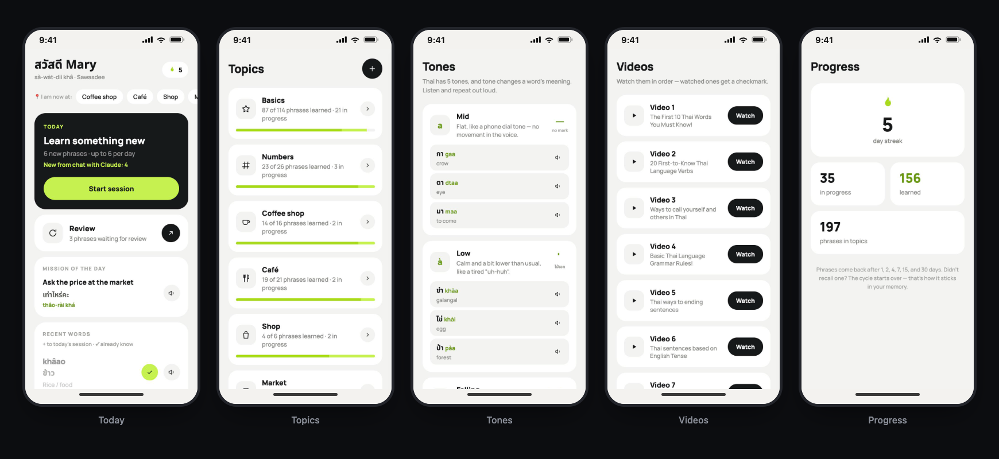

# Thai Trainer

A spoken-Thai trainer. Mobile-first PWA: spaced repetition, "I'm now at…"
cheat sheets, mini-dialogues, tones, and words from videos. The content is
hand-checked and **bundled with the app** — there is no database and nothing
to set up. Your progress is saved in your browser.

## Screenshots



## Key value
- Ready, hand-checked content (≈220 phrases across 7 topics, dialogues, tones).
- Zero setup: no backend, no accounts, no API keys.
- Deploys to Vercel (or any static Next.js host) as-is.

## Deploy to Vercel
1. Fork this repository.
2. In Vercel: **New Project → Import** your fork. Framework is detected as Next.js.
3. Deploy. That's it — no environment variables needed.

Live demo: <https://thaiapp.zerobrand.xyz>

## Run locally
```bash
npm install
npm run dev     # http://localhost:3000
npm test        # unit tests (lib/profile.js)
```

## How it works
- **Content** is bundled in `lib/content.js` (generated from a phrase list).
  The feminine particle ค่ะ/คะ is stored; set `NEXT_PUBLIC_USER_GENDER=male`
  to switch the UI to ครับ (see `.env.example`). Everything is optional.
- **Progress** (reviews, streak, hidden words, watched videos, phrases you add)
  lives in the browser via `localStorage` (`lib/store.js`). It stays on the
  device — clearing site data resets it.

## Structure
- `app/page.jsx` — shell: tabs, loading, SRS.
- `components/screens/` — screens (Today, "I'm now at…", Topics, Lesson,
  Dialogues, Tones, Progress, Videos).
- `lib/content.js` — bundled phrases (the content).
- `lib/store.js` — browser storage (progress, streak, hidden, watched, custom).
- `lib/srs.js` — spaced repetition and streak.
- `lib/profile.js` — polite particle by gender.
- `lib/data.js` — deck presentation, Thai replies, dialogues, tones, videos.
- `scripts/gen-content.mjs` — regenerate `lib/content.js` from a phrase list.

## Roadmap
See [docs/roadmap.md](docs/roadmap.md).

## License
MIT.
